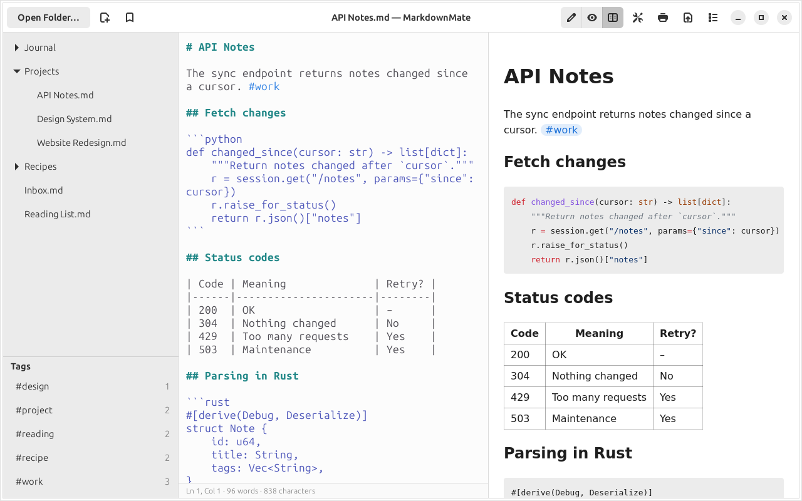
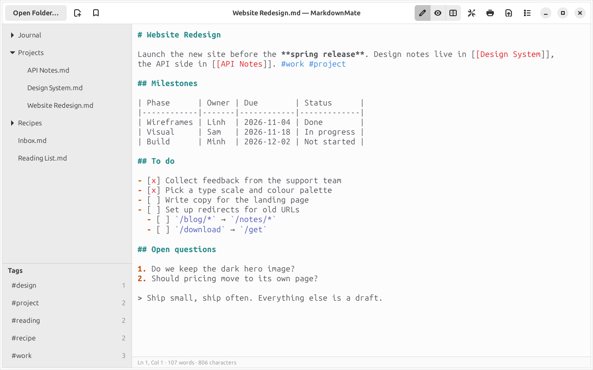

# MarkdownMate for Ubuntu

<p align="center">
  <strong>A lightweight, local-first, native markdown note-taking app for Ubuntu.</strong>
</p>

<p align="center">
  <a href="https://markdownmate.homielab.com/"></a>
  <a href="https://ko-fi.com/homielab"></a>
  
</p>

The Linux sibling of [MarkdownMate for macOS](https://github.com/homielab/markdownmate): same philosophy, same features where Linux allows, built with GTK 4 and libadwaita so it feels at home on the GNOME desktop.

> **Status:** early development. The feature list below is the target, matched against the macOS app.

<p align="center">
  
</p>
<p align="center">
  
  
</p>

<p align="center">
  
</p>

More in [`docs/screenshots/`](docs/screenshots/) (regenerate with `./dev.sh packaging/make-screenshots.sh`).

---

## 📌 Philosophy

> **Your notes should remain your files.**

Instead of locking your knowledge inside a proprietary database or cloud service, **MarkdownMate** works directly with standard markdown files and directories on your local drive.

- **Portability first:** Move, backup, or sync your folders with Git, Syncthing, Nextcloud, Dropbox, or any other tool.
- **Future-proof:** Your data is stored in plain text, ensuring you can read it decades from now.
- **Extensible:** Seamlessly index or process your files using external scripts, terminal commands, or local AI tools.

---

## ⚙️ Core Principles

- 🐧 **Native GNOME Experience**: GTK 4 + libadwaita — follows the system style, accent color, dark mode and font settings.
- ⚡ **Lightweight & Fast**: Written in Rust. Instant launch, minimal CPU usage, low memory footprint.
- 📂 **Local-First & Offline**: Work 100% offline. No cloud dependencies, no sync lags.
- 🧘 **Distraction-Free**: A clean, "Obsidian-lite" writing interface designed for focus.

---

## ✨ Key Features

Shortcuts use `Ctrl` where the macOS app uses `⌘`.

**Writing**

- **Three view modes** (Ctrl+1 / Ctrl+2 / Ctrl+3): Edit, Preview, or side by side, where the preview and the editor scroll together, either way — scrolling the preview moves the editor's view, not its cursor (Preferences ▸ Sync Scrolling, on by default).
- **Syntax highlighting**: Markdown highlighting in the editor (can be turned off); by default Markdown is also styled inline — bigger headings, real bold/italic/code, dimmed markers.
- **Smart lists**: Enter continues lists, quotes and to-dos; Tab / Shift+Tab indents (4 or 2 spaces, set in Preferences).
- **Table editing**: in a GFM table, Tab / Shift+Tab move to the next / previous cell (past the last cell a new row is added), Enter adds a row below, and Enter on an empty last row leaves the table. Each step realigns the columns (accented and wide characters counted as they display, `:-:` / `--:` alignment kept); one Ctrl+Z undoes it. Tables inside `>` quotes or indented in a list item work too, keeping each row's prefix. Shift+Ctrl+T inserts an empty aligned 3-column table (header + 2 rows) at the cursor's line, with the cursor in the first header cell (not inside a code block); on a `>` quote or list line (the item line itself included), the table stays inside the quote / list item.
- **Table commands**: with the cursor in a table, Add Row Below (Alt+Ctrl+Enter), Add Row Above (Shift+Alt+Ctrl+Enter), Delete Row (Alt+Ctrl+Backspace), Add Column (after the cursor's), Delete Column (Shift+Alt+Ctrl+Backspace), Align Column Left / Center / Right (`:--` / `:-:` / `--:`) and Format Table (lines up the columns, keeping alignment and `\|`; a `|` inside a code span splits the cell, as in the preview — write `\|` to keep it in the code). They are in the main menu ▸ Table (with Insert Table) and on the table bar (or the format bar's table section). Each is one undo step, realigns the table and leaves the cursor in its cell; the header row can't be deleted, nor the only column.
- **Code block languages**: type ```` ``` ```` (or `~~~`) at the start of a line and a letter to pick the block's language from a list of the languages the preview colours (short names such as `js`, `ts`, `py`, `sh`, `yml`, plus `math` and `mermaid`): type to filter, Up/Down to choose, Enter or Tab to insert, Esc to close. Not offered on the fence that closes a block; ```` ``` ```` then Enter is still a plain new line.
- **Copy code from the preview**: hover a code block in the preview and click Copy (copies the code without the fences; not shown when printing or in Export/Copy as HTML).
- **Check off to-dos in the preview**: click a `- [ ]` checkbox in the preview to tick it in the note (Ctrl+Z undoes it).
- **Check off to-dos in the editor**: Toggle Task (Ctrl+Enter, or main menu ▸ Format) ticks or unticks the `- [ ]` / `- [x]` items on the cursor's line or the selected lines — all ticked if any was open, else all unticked. Other lines and code blocks are left alone; one Ctrl+Z undoes it.
- **Footnotes**: main menu ▸ Format ▸ Footnote inserts `[^n]` after the cursor or selection (the smallest number not used yet) and a `[^n]: ` line at the end of the note, with the cursor there to write the note; one undo. Not in code blocks.
- **Move Line Up / Down** (Alt+Ctrl+Up / Alt+Ctrl+Down, or Alt+Up / Alt+Down; main menu ▸ Edit): move the line with the cursor, or every line the selection touches, above or below its neighbour; the selection moves with it; one undo.
- **Duplicate Line** (Shift+Ctrl+D, main menu ▸ Edit): copy the line with the cursor, or every line the selection touches, just below; the selection moves to the copy; one undo.
- **Paste a link**: select text and paste a URL (http, https, mailto) to get `[text](url)`.
- **Paste formatted text**: text copied from a browser or LibreOffice pastes as Markdown (headings, bold/italic, links, nested lists, code, quotes, simple tables; web images as ``, not downloaded; scripts and styles dropped). Shift+Ctrl+V pastes plain text; inside a code block pasting is always plain. Spreadsheet cells that arrive as plain tab-separated text (a web spreadsheet, a terminal) with two or more rows and the same two or more columns on every row paste as an aligned Markdown table (first row as the header, `|` escaped); anything else pastes as it is.
- **Format keys**: Ctrl+B bold, Ctrl+I italic (on the selection or the word at the cursor; press again to remove), Ctrl+K link (`[text](url)` with `url` selected to type over).
- **Wrap a selection**: select text and type `*`, `_`, `` ` ``, `~`, `[`, `(` or `"` to wrap it; the text stays selected, so `*` twice makes it bold.
- **Images**: paste or drop images (png, jpg, gif, webp, svg); they are saved to an `assets` folder next to the note (pasted images as `image.png`, `image 2.png`, …; existing files are never overwritten) and linked as ``. Hover an image link in the editor to see a thumbnail (images in the open folder only; web images are never downloaded), Ctrl+click a link to open it.
- **Drop files to link them**: drop other files or folders (from the sidebar or Files) into the editor to insert `[name](relative/path)` at the drop point, one link per line, the path relative to the note and percent-encoded (`a b.pdf` → `a%20b.pdf`); one Ctrl+Z removes them. Dropped images are still copied to `assets`; dragging an entry from the sidebar into the editor links it and leaves it where it is. Links to notes open in the app; other files are not opened from a note.
- **Wiki links**: `[[Note]]` and `[[Note|shown text]]` link to another note in the open folder by name (case-insensitive, `.md` optional; `[[Folder/Note]]` to pick one — otherwise a note in the same folder wins, then the shortest path). Links to missing notes are shown in red. `[[Note#Heading]]` links to a heading of that note and `[[#Heading]]` to one in the same note. Ctrl+click in the editor or click in the preview to open it (at the heading, if one is named); clicking a link to a missing note creates it (empty, `Name.md` at the top of the open folder, or beside the note without a folder; `[[Folder/Name]]` only into an existing folder) and opens it. Typing `[[` pops up matching note names; typing `#` after the name (`[[Note#`, or `[[#` for the current note, which works without an open folder) pops up that note's headings — a heading whose title repeats is linked by its id (`setup-1`).
- **Tags**: `#tag` or nested `#work/project` anywhere in a note (starting with a letter, so `#1` is not a tag; not in headings' `#`, code, or URLs/links); colored in the editor and shown as chips in the preview. The sidebar's Tags section lists them as an indented tree (by `/`) with the number of notes; a note tagged `#work/project` also counts for `#work`. Click a tag to list its notes, then click one to open it. Right-click a tag ▸ Rename Tag… to rename it in every note of the folder: `#work` becomes `#job` and nested tags move with it (`#work/project` → `#job/project`), matching any case; `#older`, tags in code, URLs and links are left alone. You see how many notes change before anything is written; the open note changes in the editor (Ctrl+Z undoes it), and a note edited elsewhere meanwhile is skipped. Renaming to a tag that already exists merges the two. The list updates in the background when notes change on disk (after saving). Typing `#` and a letter pops up the folder's existing tags that match (by prefix, or letters in order), most-used first: Up/Down to choose, Enter or Tab to insert, Esc to close (not in code or headings' `#`). The files stay plain Markdown.
- **Format bar** (Shift+Ctrl+M, or main menu ▸ Format ▸ Format Bar; off by default, remembered): a bar above the editor with buttons for Heading (each click goes one level further, `#` … `######`, then back to plain text), Bold, Italic, Strikethrough, Inline Code, Link, Bulleted / Numbered / Task List, Quote, Code Block and Insert Table. Bold, Italic and Link do what Ctrl+B / Ctrl+I / Ctrl+K do; Strikethrough and Inline Code wrap the selection or the word at the cursor in `~~` / `` ` `` (again to remove). The line buttons work on the cursor's line or every line the selection touches and toggle: all lines get the prefix (numbers count up), or lose it if they all had it; list kinds replace each other, a quote goes around a list; on a blank line they start one; code blocks are left alone. Code Block fences the lines with ```` ``` ````, or removes the fences of the block the cursor is in. While the cursor is in a table, the table bar's buttons show at the end of the format bar. Each button is one undo step and leaves the cursor in the editor; hover one for its name and shortcut. Hidden in Preview.
- **Table bar**: while the cursor is in a table and the format bar is off, a bar under the editor shows the table commands — Row: Above / Below / Delete, Column: Add / Delete, the three column alignments and Format (hover a button for its full name and shortcut); it hides again outside tables.
- **Wrap lines & line numbers**: toggle in Preferences (Ctrl+,) ▸ Editor; lines wrap by default, line numbers are off.
- **Typewriter scrolling** (Preferences ▸ Editor, off by default): the cursor's line stays in the middle of the editor as you type, move with the arrow keys or click (not while dragging a selection), with room below the text so the last line can reach the middle too.
- **Spell check** (Preferences ▸ Editor ▸ Check Spelling; on by default, remembered): misspelled words are underlined as you type. Right-click one for suggestions, Add to Dictionary or Ignore; the same menu has Check Spelling (the same switch) and Languages (for the open window only). The language is your system's, or US English if no dictionary covers it (add one with `sudo apt install hunspell-<code>`, e.g. `hunspell-fr`). Inline code, ```` ``` ```` code blocks and link URLs are skipped; `~~~` code blocks and code indented by 4 spaces are checked like text (GtkSourceView's Markdown rules). A note is checked from the top down in the background without slowing typing: a typical note in a few seconds, about 3 minutes per MB. Notes over 1 MB are not checked, so a huge note never keeps the check busy for minutes: the status bar says *Spell check is off for notes over 1 MB*, and right-click ▸ Check Spelling checks that note anyway (until you open another one; `docs/PERFORMANCE.md`).
- **Focus Mode** (Shift+Ctrl+J, or main menu ▸ Focus Mode; off by default, remembered): the editor dims every paragraph except the one you are writing in. A paragraph is a block of lines between blank lines (so a table or a code block without blank lines is one), and in a list each item is its own paragraph; on a blank line every paragraph is dimmed (the cursor's line stays bright), and with a selection the paragraphs it touches stay bright. Dimmed text keeps its colours (headings, links, code), faded, in every theme, light or dark; find highlights, spelling underlines and images on dimmed lines fade with it; works with typewriter scrolling. Only the editor's display changes: the note, the preview, print and exports are untouched.
- **Line spacing & text width** (Preferences ▸ Editor): Line Spacing 1, 1.15, 1.3, 1.5 or 2 (1 by default); Text Width Narrow (680 px), Medium (820 px), Wide (1080 px) or Full Width (Medium by default) keeps long lines readable on wide screens: the editor's text is centred at most that wide, and so is the preview's page; Full Width has no limit in either, so the text fills the window edge to edge (the side padding stays). Print and exports are unchanged.
- **Go to Line** (Ctrl+L): jump to a line, or `line:column` (1-based; past the end goes to the last line / line end).
- **Find & Replace** (Ctrl+F / Ctrl+H): a bar above the editor. Ctrl+F searches as you type (case-insensitive, also for Vietnamese and other accented text; a selection on one line becomes the search text), highlights every match and selects the next one after the cursor; `N of M` shows where you are (`No results` in red). Enter or Ctrl+G goes to the next match, Shift+Enter or Shift+Ctrl+G to the previous one, wrapping around. Ctrl+H adds the Replace row: Replace (Enter in the Replace box) replaces the current match and moves on, Replace All (Ctrl+Enter) replaces every match in one step that a single Ctrl+Z undoes. Esc closes the bar and returns to the editor. From Preview, Ctrl+H switches to the editor first. Changes are saved by auto-save like any edit.
- **Find in Preview** (Ctrl+F in Preview, or in Side by side with the preview focused): a find bar above the rendered note. It searches as you type (case-insensitive), highlights every match and shows how many there are (`No results` in red); Enter or Ctrl+G goes to the next match, Shift+Enter or Shift+Ctrl+G to the previous one, wrapping around. Esc closes the bar and clears the highlights. There is no Replace here: edit in the editor.
- **Status bar** under the editor: `Ln X, Col Y · N words · M characters` (counts the selection when there is one; Markdown markers are not counted as words).
- **Themes**: Default, Paper, Graphite and Solarized, each in Light and Dark (following the Style setting), for the editor and the preview; pick one in Preferences ▸ Appearance. Print and Export as HTML always use Default light.

**Preview**

- **Rich rendering**: GitHub-flavored Markdown with code highlighting and footnotes — fully offline. YAML front matter (`---` on the first line, as in Obsidian/Jekyll/Hugo) shows as a small dimmed block in the preview and is left out of Export, Copy as HTML and Print.
- **Web images** (Preferences ▸ Privacy ▸ Load Images from the Web, off by default): with it off nothing leaves your computer — `http(s)` images are not downloaded in Preview, Side by side, Print or Export, the preview shows their alt text and a line saying why. Turn it on to show them there as in the macOS app; only images load from the web, never scripts, styles or anything else. An exported HTML file always lets the browser that opens it load them.
- **Line breaks** (Preferences ▸ Appearance ▸ Line Breaks): *Markdown Standard* (default) joins lines of a paragraph as Markdown does; *Every New Line* shows each newline as a line break, as in the macOS app — in Preview, Side by side, Print, Export as PDF / HTML and Copy as HTML / Rich Text. Plain-text and RTF exports and the editor are unchanged.
- **Mermaid diagrams**: a ```` ```mermaid ```` code block shows as a diagram (flowcharts, sequence, class, state, Gantt, pie, …) in Preview and Side by side, in the light or dark colours of the current style. A diagram with a mistake stays a code block with a short error line under it. While you type, only the diagram you edit is drawn again. Mermaid is bundled (no network) and loaded only for notes that have a diagram, so other notes open as fast as before. Print and Export as PDF / HTML show the diagrams too (exported as plain SVG); Copy as HTML keeps them as code.
- **Math**: `$…$` (inline), `$$…$$` and ```` ```math ```` blocks (display) are typeset by KaTeX in Preview and Side by side — fractions, matrices, `\begin{aligned}`, most LaTeX math macros — in the text colour of the current style, light or dark. A formula with a mistake shows its source in red; hover it for KaTeX's message. While you type, only the formula you edit is typeset again. KaTeX and its fonts are bundled (no network) and loaded only for notes that have a formula. Print and Export as PDF / HTML typeset them too (the exported file embeds KaTeX's styles and fonts, no script); Copy as HTML gives MathML, which mail and office apps can paste. `$5 and $10` stays text.
- **Alerts**: a quote whose first line is only `[!NOTE]`, `[!TIP]`, `[!IMPORTANT]`, `[!WARNING]` or `[!CAUTION]` (any case) shows as a coloured callout with its title, as on GitHub — blue, green, purple, amber or red, in light and dark — in Preview, Side by side, Print, Export as PDF / HTML and Copy as HTML / Rich Text. `> [!NOTE] text` on one line, an unknown kind such as `[!FOO]` and a marker in code stay as written. Plain-text and RTF exports keep the quote with its `[!NOTE]` line.
- **Table of contents**: a paragraph that is only `[TOC]` (any case) shows the note's headings as a nested list of links that jump to each heading — every heading before and after it, `#` to `######`, not those in code or front matter — and follows your edits as you type. Preview, Side by side, Print, Export as PDF / HTML and Copy as HTML; Copy as Rich Text and the plain-text and RTF exports keep `[TOC]` as written. `[TOC] text`, `[TOC]` in a quote, a list or code stay as written; no headings, nothing shows.
- **Links between notes**: click (in the preview) or Ctrl+click (in the editor; the pointer becomes a hand over links) a relative link to another note (`[Plan](Projects/Plan.md)`, `../Other%20Note.md`; with a `#heading` anchor such as `Plan.md#next-steps` it opens scrolled to that heading, the editor's cursor on its line) to open it; only existing Markdown files inside the open folder are opened (no `..` or symlink escapes). Web links (`http`, `https`, `mailto`, also bare URLs and `<…>` in the editor) open in the default app; other schemes are ignored. Ctrl+click on an image link in the editor opens the image in the default app if it is inside the open folder. Links in code are not clickable.
- **Keeps up with large files**: while you type, the preview updates in place and only the code blocks you changed are highlighted again; a note's code blocks are highlighted on all CPU cores at once. Backlinks of a note in a folder of 10,000 notes list in about 0.3 s. Timings for 1 MB and 5 MB notes and a 10,000-note folder: [`docs/PERFORMANCE.md`](docs/PERFORMANCE.md).

**Folders & navigation**

- **Folder sidebar**: open a folder (Open… takes a file or a folder; recent folders are listed; Files ▸ Open With ▸ MarkdownMate), create, rename, delete (to the Trash), and drag a note or folder onto a folder (or empty space = the open folder) to move it, never overwriting. Renaming or moving a note or folder in the sidebar asks whether to update the links to it in the folder's notes — wiki links, relative `.md` links and images, not in code — and a moved note's own relative links (Don’t Update is the default; renames in Files change nothing). Drop `.md` notes from Files or the desktop onto the sidebar to copy them in the same way (a taken name gets a number, e.g. `Note 2.md`; other files are skipped); follows changes on disk. Right-click an entry for Show in Files (opens Files with it selected) and Copy Path (its full path on the clipboard); on a note, Copy Wiki Link copies `[[Name]]` ready to paste, or `[[Folder/Name]]` when another note in the folder has the same name. Bookmark folders and switch between them (Alt+1…Alt+9).
- **Sort the sidebar** (main menu ▸ Sort Sidebar By, or Sort By in an entry's right-click menu): by Name, Date Modified or Date Created, one setting for every folder, remembered. Folders always come first, by name; names sort naturally (`Note 2` before `Note 10`, case and accents ignored); dates are newest first, so today's notes are on top, and a note you save (or another app changes) moves up right away without closing any folder. Date Created is the file's creation time where the file system records it (ext4, Btrfs), else its modification time; saving replaces the file (the safe way MarkdownMate and most editors write), so on Linux a note saved here counts as newly created.
- **Bookmarks** (bookmark button in the header bar): bookmark the open folder (Bookmark This Folder / Remove Bookmark) and pick a bookmark from the list to open it; Alt+1…Alt+9 open the first nine. A bookmarked folder that no longer exists is skipped with a message. Below the bookmarks, **Recent** lists the last 10 folders you opened (newest first, the open one left out); click one to open it. A recent folder that no longer exists is removed from the list with a message.
- **Outline** (Alt+Ctrl+O or the list button in the header bar): a side panel with the headings of the current note (`#`…`######` and underlined `===` / `---`, not those in code blocks), indented by level and updated as you type; click a heading or press Enter on it to jump to its line in the editor. Right-click (or long-press) a heading → **Copy Link** copies `[[Note#Heading]]` to the clipboard, ready to paste into another note. The heading of the section the cursor is in stays highlighted as you move around, without taking focus from the editor.
- **Backlinks**: under the outline, the notes that link to the current note — by `[[Note]]` / `[[Note|text]]` / `[[Note#heading]]` (same matching as the preview) or a relative Markdown link such as `[text](../Note.md)`; links inside code are ignored. Each entry shows the note name and the linking line; click it (or press Enter) to open that note at that line. Refreshed when you switch notes, after the folder is rescanned and when a note changes on disk; "No backlinks" when none. The links of every note are read once in the background when the folder opens and kept up to date, so the list appears at once even in large folders.
- **Unlinked Mentions**: below Backlinks, a collapsed section listing the notes that name the current note without linking to it — its file name as a whole word, in any case, not inside code or an existing link or wiki link (names shorter than 3 characters are not looked for). It searches only while expanded, in the background, so large folders stay responsive. Each entry shows the note name and the line; click it (or press Enter) to open that note at that line. Refreshed like Backlinks. The **Link** button on an entry turns that mention into a wiki link to the current note, at once: `[[Name]]` (`[[Folder/Name]]` when another note has the same name, as Copy Wiki Link) when it matches the name apart from case and accents, else `[[Name|mention as written]]`. If the note changed since the list was made and the mention is no longer where it was found, nothing is written and a message says so; the list then updates.
- **Today's Note** (Ctrl+D, or main menu ▸ Today's Note): opens `YYYY-MM-DD.md` for today's date in the daily notes folder of the open folder (Preferences ▸ Notes ▸ Daily Notes Folder, `Daily` by default, a path relative to the open folder; empty = the open folder itself). The first time each day it creates the note, starting from a `Template.md` in that folder (replacing `{{date}}` and `{{title}}` with the date), or `# YYYY-MM-DD` and a blank line if missing or unreadable, and opens with the cursor at the end; after that it just opens it. Unavailable until a folder is open.
- **New from Template** (main menu ▸ New from Template): lists the `.md` notes in the templates folder of the open folder (Preferences ▸ Notes ▸ Templates Folder, `Templates` by default, a path relative to the open folder like the daily notes folder), by name without the extension. Picking one creates `Untitled.md` (`Untitled 2.md`, … if taken; never overwrites) in the open note's folder, or the open folder, with the template's text, `{{date}}` replaced by today's date (`YYYY-MM-DD`) and `{{title}}` by the new note's name, and opens it with the cursor at the end. No templates: a greyed-out "No Templates"; unavailable until a folder is open.
- **Open Quickly** (Ctrl+P): jump to any file by name; with the box empty it lists the notes you opened last, so Ctrl+P, Enter goes back to the previous note; when nothing matches, Enter creates a note with that name.
- **Find in Folder** (Shift+Ctrl+F): full-text search across all notes in the folder, fast even with thousands of files. Match Case and Whole Word toggles under the search box (both off by default, remembered across restarts).
  **Replace All** under the search box replaces every listed match (follows Match Case and Whole Word; your replacement is inserted exactly as typed, no regex) in all result notes, after confirming "Replace N matches in M notes?". Ctrl+Z undoes it in the open note; a note changed on disk after the search is left alone and named. The search then runs again.
- **Other files**: images open in a built-in viewer; anything else opens in its default app.

**And also**

- **Main menu** (the menu button at the left of the header bar, or F10): New File / New Folder… / New from Template / Today's Note, Open File… (a `.md` note opens with its folder) / Open Folder… (Ctrl+O), Open Recent, Edit (Move Line Up / Down, Duplicate Line), Format (Toggle Task, Footnote, Format Bar) and Table (Insert Table and the table commands), Export as PDF… / Export as HTML… / Export as Plain Text… / Export as RTF… / Copy as HTML / Copy as Rich Text / Print…, Keyboard Shortcuts (Ctrl+?), About MarkdownMate.
- **Export as PDF…** (main menu): the note as Print renders it, saved straight to a PDF (suggested as `<note>.pdf` next to the note) without the print dialog.
- **Export as HTML…** (Shift+Ctrl+E or the main menu): one standalone `.html` file (CSS embedded, light theme, code highlighting, KaTeX formulas, Mermaid diagrams as SVG, no script), suggested as `<note>.html` next to the note. Relative images and links stay relative, so keep the file next to the note (or copy its images along); wiki links become relative links to the target note, unresolved ones plain text.
- **Export as RTF…** (main menu): the note as a `.rtf` file (suggested as `<note>.rtf` next to the note) that opens formatted in LibreOffice Writer, AbiWord and other word processors: headings (bold, larger), bold, italic and strikethrough, links, bullet, numbered and to-do lists with indentation, quotes indented, code and inline code in a monospace font, tables with borders, formulas as their TeX, images as `alt (path)` text. Front matter and raw HTML are left out; accents, Vietnamese and emoji are kept.
- **Export as Plain Text…** (main menu): the note without Markdown syntax in a `.txt` file (suggested as `<note>.txt` next to the note): headings as their text, bullets as `• ` (numbered lists keep their numbers, to-dos become `[ ]` / `[x]`), links as `text (url)`, code kept as written, formulas as their TeX between `$` / `$$`, tables as tab-separated rows, quotes with `> `. Front matter and raw HTML are left out.
- **Copy as HTML** (Alt+Shift+Ctrl+C): copies the selection (or the whole note) so it pastes formatted into rich-text apps (mail, Docs) and as Markdown into plain-text apps. No page styling or script; code blocks are plain monospace (no colours), formulas MathML; links as in Export as HTML (wiki links relative, unresolved ones plain text).
- **Copy as Rich Text** (main menu, no shortcut): copies the selection (or the whole note) so it pastes formatted into LibreOffice, Thunderbird and web mail — headings, bold and italic, lists, links, tables (with borders), code in monospace, formulas as MathML, diagrams as code — and as plain text (the Export as Plain Text output) into plain-text apps. Images in the open folder go along inside the copy; web images stay links to the web; other images are left out.
- **Print…** (Shift+Ctrl+P or the main menu): the note as the preview renders it (unsaved edits included, always light, no background), from Edit, Preview or Side by side, to a printer or GTK's Print to File (PDF). Code blocks, tables and images are kept off page breaks where they fit.
- **Auto-save** directly to disk, and **Reload** (Ctrl+R) from disk — with unsaved edits it asks first (Reload drops them and clears undo).
- **Session restore**: reopens your folder and note, the cursor position in each note (the last 100 notes; a target line from Find in Folder / Go to Line wins) and the expanded sidebar folders.
- **Preferences** (Ctrl+, or the header-bar button): editor font and size (system monospace by default), line numbers, line wrapping, list indent width (2 / 4 spaces), line spacing, text width, typewriter scrolling, spell check, style, theme, sync scrolling, loading images from the web. Changes apply at once and are remembered. Preferences ▸ Default App shows whether MarkdownMate opens Markdown files (`text/markdown`, `text/x-markdown`) and has a Make Default button that sets it (the same as Files ▸ Open With ▸ Set as default); it needs the installed package, and a failure shows a message at the bottom of the window. Nothing asks at launch.
- **Light / Dark / System** appearance: Preferences ▸ Appearance ▸ Style (System by default) switches the window, editor and preview at once and is remembered.
- **Zoom** (Ctrl+= or Ctrl++ in, Ctrl+− out, Ctrl+0 back to 100%): editor text and preview, 10% steps from 50% to 300%, remembered. The sidebar and header bar keep their size; Print and Export HTML are not zoomed.
- **Default app** for `.md` files, if you want it.

Not ported (macOS-only): Services menu, Share sheet, Shortcuts/Siri actions, Quick Look, iCloud integration.

---

## 🔗 URL Scheme

Automate MarkdownMate from a launcher (Ulauncher, Albert, GNOME Shell extensions) or a script with `markdownmate://` links. Parameters are URL-encoded; `+` also means a space.

| Action | Parameters | Example |
|---|---|---|
| `open` | `path`: relative to the open folder, or absolute | `markdownmate://open?path=Projects/Plan.md` |
| `create` | `title` (file name) and/or `text`; new note at the open folder's top (numbered if the name is taken); without an open folder nothing is created ("Open a folder first") | `markdownmate://create?title=Idea&text=Call%20Anna` |
| `append` | `path`, `text`: opens the note and adds the text at the end on a new line (one undoable edit, saved like typing) | `markdownmate://append?path=Inbox.md&text=Buy%20milk` |

From a terminal: `xdg-open "markdownmate://create?title=Test&text=Hi"`.

A note in a bookmarked folder that is not open opens that folder (the current note is saved first). If MarkdownMate is not running, the link starts it; otherwise the running window handles it.

For safety (any web page can open such a link), links only reach existing Markdown (`.md`/`.markdown`) files inside the open folder or a bookmarked folder (no `..`, symlinks are followed and checked), `create` never overwrites, `text` is limited to 1 MB, and `append` never creates a file and always brings the note's window forward, so nothing is changed unseen. A bad or unsafe link only shows a message.

---

## ☁️ Sync

MarkdownMate has no sync of its own, but your notes are plain files, so any file sync works: [Syncthing](https://syncthing.net), Nextcloud, Dropbox, or Git. Keep your notes in the synced folder and open it with Open…. Changes made on another device show up in the sidebar and in open notes automatically. Avoid editing the same note on two devices at once — most sync tools will then keep both versions as separate files.

---

## 🛡️ Privacy

MarkdownMate is built with a strict local-first architecture. **We do not collect, store, or transmit any user data.**

- 🚫 **No Telemetry & Analytics.**
- 🚫 **No Cloud Database:** no accounts, no sign-ups.
- 🚫 **No External Crash Reporting.**

Your files and settings stay where they belong: **on your machine**. The only file the app keeps for itself is `~/.config/markdownmate/state` (last open folder, note and Edit/Preview mode, so they reopen on next launch); delete it to start fresh.

---

## 🧱 Tech Stack

| Part | Choice |
|---|---|
| Language | Rust (stable) |
| UI | [GTK 4](https://gtk-rs.org) + [libadwaita](https://gnome.pages.gitlab.gnome.org/libadwaita/) |
| Editor | [GtkSourceView 5](https://wiki.gnome.org/Projects/GtkSourceView); spell check by [libspelling](https://gitlab.gnome.org/GNOME/libspelling) (enchant / Hunspell dictionaries) |
| Preview | [WebKitGTK 6](https://webkitgtk.org), page scripts off (the page's Content-Security-Policy blocks scripts and every network load); code highlighted in Rust by [syntect](https://github.com/trishume/syntect) (light/dark CSS classes; its default syntaxes plus TypeScript / TSX from `resources/syntaxes/`, Apache-2.0, compiled into one embedded set); math typeset by [KaTeX](https://katex.org) 0.18 (MIT, bundled with its fonts in `resources/katex/`), which only notes with a formula load, into the app's isolated script world, over the MathML from [math-core](https://crates.io/crates/math-core) that stays the fallback (no script, Copy as HTML); ```` ```mermaid ```` diagrams drawn by [Mermaid](https://mermaid.js.org) 11 (MIT, bundled in `resources/mermaid/`), which only notes with a diagram load, into the app's own isolated script world (not the page's) with Mermaid's `strict` security level |
| Markdown | [comrak](https://github.com/kivikakk/comrak) (CommonMark + GFM) |
| Packaging | `.deb`, published in the Launchpad PPA `ppa:homielab/markdownmate` |

---

## 🚀 Getting Started

### Install the .deb

Build the package (in Docker, see below) and install it on Ubuntu 24.04+:

```bash
./dev.sh scripts/package-deb.sh          # → dist/markdownmate_<version>_<arch>.deb
sudo apt install ./dist/markdownmate_*_$(dpkg --print-architecture).deb
```

This installs `markdownmate` to `/usr/bin`, a launcher (`com.homielab.MarkdownMate.desktop`, registered for `.md` files so Files ▸ Open With ▸ MarkdownMate works) and an icon (temporary). `markdownmate note.md` opens the note's folder with that note; `markdownmate ~/Notes` opens a folder; with no argument the last session is reopened.

The package is built for the container's architecture (arm64 on an Apple Silicon Mac, amd64 on a PC). To build the other one, set `ARCH` (an emulated container with its own image and build cache; on an Apple Silicon Mac with OrbStack it runs via Rosetta, first build ~15 min plus ~4 min for the image):

```bash
ARCH=amd64 ./dev.sh scripts/package-deb.sh   # → dist/markdownmate_<version>_amd64.deb
ARCH=amd64 scripts/check-deb.sh
```

`scripts/check-deb.sh` (run on the host) installs the package for its container's architecture (`ARCH`, default the host's) in a clean `ubuntu:24.04` container, runs `desktop-file-validate`, parses the AppArmor profile, and starts the installed app on Xvfb with a note given on the command line, then once more without the sandbox override (it must stay up with the preview off).

### Troubleshooting: "Preview unavailable: the system blocks WebKit's sandbox"

The preview runs in WebKit's sandbox (bubblewrap), which needs unprivileged user namespaces. Ubuntu 23.10+ only allows them for programs with an AppArmor profile that grants `userns`, so the package installs `/etc/apparmor.d/markdownmate` (for `/usr/bin/markdownmate`) and loads it on install. If the preview still says it is unavailable:

- Reload the profile: `sudo apparmor_parser -r /etc/apparmor.d/markdownmate`, then restart the app.
- A binary run from elsewhere (e.g. `target/release/markdownmate`) is not covered by the profile; install the package, or for testing only run it with `WEBKIT_DISABLE_SANDBOX_THIS_IS_DANGEROUS=1`.

Without a usable sandbox the app stays in Edit mode instead of crashing. If the preview's web process crashes, a toast offers Reload.

### Troubleshooting: crashes or a blank preview with some graphics drivers

The preview (WebKitGTK) can hand its frames to GTK as GPU buffers (DMA-BUF). With some drivers, such as Intel graphics on Ubuntu 24.04 (the journal shows `MESA-INTEL: warning: … FINISHME: support YUV colorspace with DRM format modifiers`), that path is known to crash or blank WebKitGTK apps, so MarkdownMate starts with `WEBKIT_DISABLE_DMABUF_RENDERER=1` unless you set the variable yourself: the preview is then copied through shared memory, which a static page doesn't notice. To check whether a crash depends on the graphics stack, start the app from a terminal with other settings; a value you set always wins:

```bash
WEBKIT_DISABLE_DMABUF_RENDERER=0 markdownmate   # back to GPU buffers for the preview
GSK_RENDERER=gl markdownmate                    # GTK's OpenGL renderer (also: ngl, vulkan, cairo)
GDK_BACKEND=x11 markdownmate                    # XWayland instead of Wayland
```

`coredumpctl list markdownmate` and `coredumpctl info <PID>` show the backtrace of a crash.

On a machine without a GPU (a VM, remote desktop), GTK's OpenGL renderer runs on Mesa's software rasterizer and takes about 140 MB more memory than `GSK_RENDERER=cairo markdownmate`; see [`docs/PERFORMANCE.md`](docs/PERFORMANCE.md#memory).

### Release: Launchpad PPA source package

Releases go to the PPA `ppa:homielab/markdownmate`. A PPA only takes a source package; Launchpad builds it itself, offline, with Ubuntu's `rustc-1.91`/`cargo-1.91`. The packaging is in `debian/` (licence: all rights reserved, see `debian/copyright`).

```bash
./dev.sh packaging/build-source.sh -us -uc   # unsigned → dist/ppa/markdownmate_<version>.orig.tar.xz, .dsc, _source.changes
scripts/check-source.sh                      # on the host: build it like Launchpad and start the app
```

To release: bump `version` in `Cargo.toml`, move the `## Unreleased` notes in `CHANGELOG.md` under `## <version>`, add the version to `debian/changelog` (`dch -v <version>-0ppa1 -D noble "New upstream release."`), commit, then push a tag `v<version>`. `.github/workflows/ppa.yml` builds the source package, signs it with the `PPA_GPG_PRIVATE_KEY`/`PPA_GPG_PASSPHRASE` repo secrets, checks the signature against keyserver.ubuntu.com and runs `dput`; Launchpad emails contact@homielab.com on accept/reject, then builds. A version already in the PPA is skipped (for a packaging-only fix bump `-0ppa2`). Re-run for an existing tag: `gh workflow run ppa.yml -f tag=v<version>`.

- `packaging/build-source.sh` puts every file git knows about (except `debian/`, so `CHANGELOG.md` included) into the `.orig.tar.xz`, plus `vendor/`: all crates from `Cargo.lock`, fetched by `cargo vendor` (needs network) — about 8 MB compressed. `vendor/` is never committed to git. The version in `Cargo.toml` must match `debian/changelog` (`dch -v <version>-0ppa1 -D noble "New upstream release."`). To upload by hand (the container has no GPG key): `debsign -k <key> dist/ppa/markdownmate_<version>-0ppa1_source.changes` on a machine with the key registered on Launchpad, then `dput ppa:homielab/markdownmate` with the same file.
- `debian/rules` builds with `cargo --offline --locked` against `vendor/` (via `--config` flags, so `./dev.sh cargo …` is unaffected), runs the unit tests, and installs the files with `scripts/package-deb.sh --stage` (the same layout as the manual `.deb`).
- `scripts/check-source.sh` (needs Docker) installs the build-deps in a clean `ubuntu:24.04` container, then with the network off runs lintian (fails on `E:`) and `dpkg-source -x` + `dpkg-buildpackage -b` as a user without a writable HOME, and finally runs `scripts/check-deb.sh` on the resulting `.deb` (in `dist/ppa-deb/`). `ARCH=amd64` for the emulated amd64 build.

### Prerequisites

- Ubuntu 24.04+ (or any distro with GTK ≥ 4.14, libadwaita ≥ 1.5)
- Rust via [rustup](https://rustup.rs)
- System libraries:
  ```bash
  sudo apt install build-essential pkg-config \
    libgtk-4-dev libadwaita-1-dev libgtksourceview-5-dev libwebkitgtk-6.0-dev \
    libspelling-1-dev
  ```

### Build from Source

```bash
git clone https://github.com/homielab/markdownmate-linux.git
cd markdownmate-linux
cargo run --release
```

Run the tests:

```bash
cargo test
```

### Build in Docker (macOS or any machine without GTK)

No Rust or GTK needed on the host, only Docker (e.g. OrbStack on macOS). `./dev.sh` builds an Ubuntu 24.04 image from the `Dockerfile` (first run takes a few minutes; it is rebuilt only when the `Dockerfile` changes) and runs the given command inside it with the repo mounted at `/work`:

```bash
./dev.sh cargo build
./dev.sh cargo test
./dev.sh cargo clippy --all-targets -- -D warnings
./dev.sh            # interactive shell in the container
```

CI (`.github/workflows/ci.yml`) runs `cargo fmt --check`, `cargo clippy --all-targets -- -D warnings` and `cargo test` on every push and pull request to `main`, on `ubuntu-24.04`; run the same three commands through `./dev.sh` before pushing.

The cargo registry and build output live in Docker volumes (`markdownmate-cargo-registry`, `markdownmate-target`), so later runs are fast and no `target/` appears in the repo. Dev builds keep only line tables as debug info (`[profile.dev]` in `Cargo.toml`), so backtraces still show file:line while the target volume stays smaller (about 0.75 GB after `cargo build --tests`).

When you're done with a work session or a release, free the space with:

```bash
./dev.sh clean
```

It removes the build output (`markdownmate-target`, and `markdownmate-target-amd64` after `ARCH=amd64` runs), the `markdownmate-dev-amd64` image, any leftover `markdownmate-srccheck-*` image or container, and old untagged `markdownmate-dev` images left behind by `Dockerfile` changes (found by their `LABEL`). It keeps the `markdownmate-dev` image and the `markdownmate-cargo-registry` volume, so the next build only recompiles; it never touches other Docker objects. To start completely fresh, also `docker volume rm markdownmate-cargo-registry`.

Packaging (`scripts/package-deb.sh`, `packaging/build-source.sh`, `scripts/check-source.sh`, `scripts/check-deb.sh`) is only needed when preparing a release; day-to-day work needs just `cargo build`, `clippy` and `fmt` through `./dev.sh`. `scripts/check-source.sh` removes its temporary build-deps image and containers when it exits, pass or fail.

The container has no display, but the app can be smoke-tested headless:

```sh
./dev.sh scripts/smoke.sh
```

It opens a temporary sample note folder on a virtual X display (Xvfb), saves screenshots to `screenshots/` (gitignored: `edit.png`, `edit-keys.png` with Open Quickly, `preview.png`, `find.png` / `find-opened.png` with Find in Folder, `link.png` after clicking a link to another note) plus the app's stderr (`*.log`), and exits non-zero if the app dies or prints a panic or GTK `CRITICAL`. For this test only it sets `WEBKIT_DISABLE_SANDBOX_THIS_IS_DANGEROUS=1`, because WebKit's sandbox cannot run inside the container; the `nosandbox` step runs without it to check the app falls back to Edit instead of aborting.

To time opening and previewing 1 MB and 5 MB notes (and compare the rendered HTML of two builds), or launch, the sidebar, Tags, Backlinks and memory with a generated 10,000-note folder (`./dev.sh scripts/measure-folder.sh`), see [`docs/PERFORMANCE.md`](docs/PERFORMANCE.md).

---

## 💬 Support & Connect

- **Landing Page:** [markdownmate.homielab.com](https://markdownmate.homielab.com/)
- **macOS version:** [homielab/markdownmate](https://github.com/homielab/markdownmate)
- **Support Development:** If you find MarkdownMate useful, consider supporting its development via [Ko-fi](https://ko-fi.com/homielab).

---

Built with ❤️ by [HomieLab](https://homielab.com).
