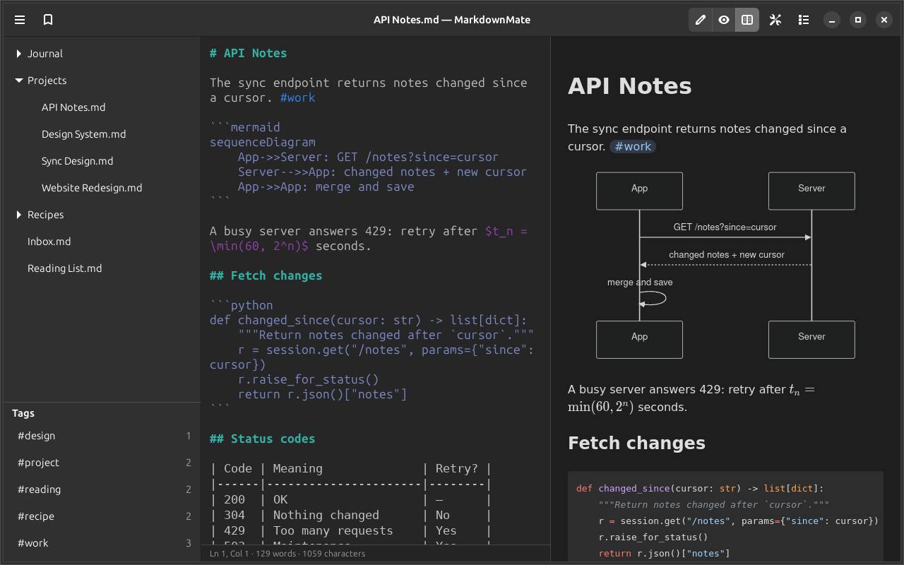
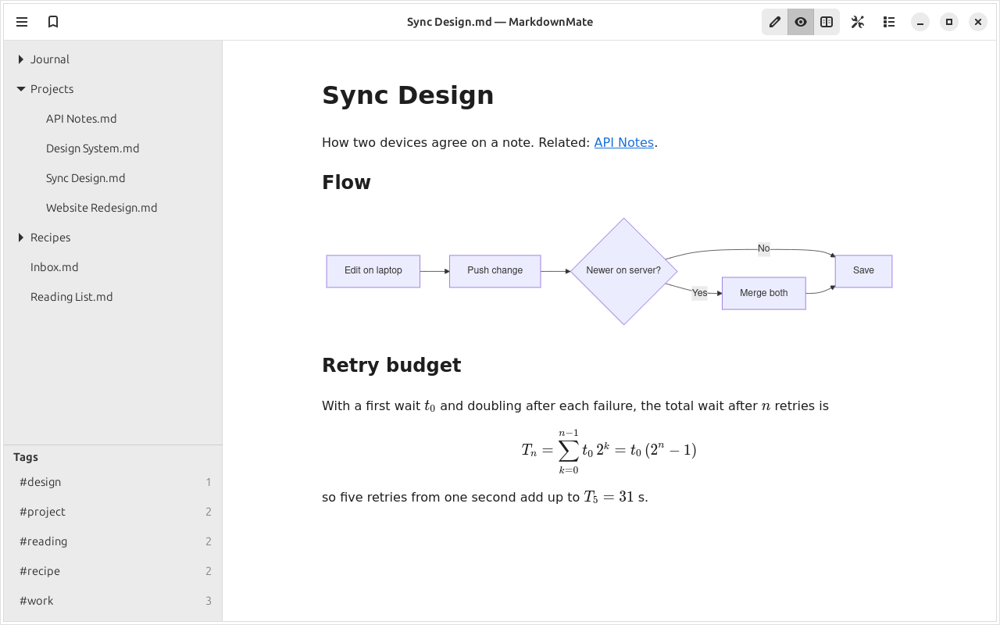

# MarkdownMate for Ubuntu

<p align="center">
  <strong>A lightweight, local-first, native markdown note-taking app for Ubuntu.</strong>
</p>

<p align="center">
  <a href="https://markdownmate.homielab.com/"></a>
  <a href="https://ko-fi.com/homielab"></a>
  
</p>

The Linux sibling of [MarkdownMate for macOS](https://github.com/homielab/markdownmate): same philosophy, same features where Linux allows, built with GTK 4 and libadwaita so it feels at home on the GNOME desktop.

> **Status:** early development. The feature list below is the target, matched against the macOS app.

<p align="center">
  
</p>
<p align="center">
  
  
</p>

<p align="center">
  
</p>

More in [`docs/screenshots/`](docs/screenshots/) (regenerate with `./dev.sh packaging/make-screenshots.sh`).

---

## 📌 Your notes stay your files

MarkdownMate works directly with Markdown files and folders on your disk — no database, no account, no cloud. Sync or back them up with Git, Syncthing, Nextcloud or Dropbox, read them decades from now, and process them with scripts or local AI tools.

- 🐧 **Native GNOME**: GTK 4 + libadwaita; follows the system style, accent colour, dark mode and fonts.
- ⚡ **Fast**: written in Rust; launches instantly, uses little CPU and memory.
- 📂 **Offline**: everything works without a connection.
- 🧘 **Focused**: a clean writing view with nothing in the way.

---

## ✨ Key Features

- **Edit, Preview or side by side** (Ctrl+1/2/3), with scroll sync, inline Markdown styling, smart lists, auto-pairing, spell check and a format bar.
- **Rich preview**: GitHub-flavored Markdown, code highlighting, KaTeX math, Mermaid diagrams, callouts, footnotes, front matter and `[TOC]` — fully offline.
- **Wiki links**: `[[Note]]`, `[[Note#Heading]]` and `[[Note#^block]]` with completion, hover previews, aliases, `![[embeds]]`, backlinks and unlinked mentions.
- **Tags**: `#tag` and `#nested/tags`, inline or in front matter, listed as a tree in the sidebar; rename a tag across the folder.
- **Daily notes and templates**: Today's Note (Ctrl+D) with your own name format, plus templates with `{{date}}`, `{{title}}` and `{{cursor}}`.
- **Find in Folder** (Shift+Ctrl+F): fast full-text search and replace with regex and `tag:` / `path:` operators; lists broken links, open tasks and unused attachments.
- **Open Quickly** (Ctrl+P): jump to any note, alias, favourite or heading; Back and Forward like a browser.
- **Tables and images**: Tab between cells, auto-aligned columns; pasted images saved next to the note, optionally scaled down.
- **Export**: PDF, HTML, Word, RTF and plain text, a whole folder as a website, Copy as HTML / Rich Text and Print.
- **Themes**: Default, Paper, Graphite and Solarized, light and dark, with focus mode and typewriter scrolling.
- **Automation**: `markdownmate://` links and command-line options (below).

Every feature with its menu and shortcut: [docs/FEATURES.md](docs/FEATURES.md). Not ported (macOS-only): Services menu, Share sheet, Shortcuts/Siri actions, Quick Look, iCloud integration.

---

## 🔗 URL Scheme

Automate MarkdownMate from a launcher (Ulauncher, Albert, GNOME Shell extensions) or a script with `markdownmate://` links. Parameters are URL-encoded; `+` also means a space.

| Action | Parameters | Example |
|---|---|---|
| `open` | `path`: relative to the open folder, or absolute | `markdownmate://open?path=Projects/Plan.md` |
| `create` | `title` (file name) and/or `text`; new note at the open folder's top (numbered if the name is taken); without an open folder nothing is created ("Open a folder first") | `markdownmate://create?title=Idea&text=Call%20Anna` |
| `append` | `path`, `text`: opens the note and adds the text at the end on a new line (one undoable edit, saved like typing) | `markdownmate://append?path=Inbox.md&text=Buy%20milk` |

From a terminal: `xdg-open "markdownmate://create?title=Test&text=Hi"`.

A note in a bookmarked folder that is not open opens that folder (the current note is saved first). If MarkdownMate is not running, the link starts it; otherwise the running window handles it.

For safety (any web page can open such a link), links only reach existing Markdown (`.md`/`.markdown`) files inside the open folder or a bookmarked folder (no `..`, symlinks are followed and checked), `create` never overwrites, `text` is limited to 1 MB, and `append` never creates a file and always brings the note's window forward, so nothing is changed unseen. A bad or unsafe link only shows a message.

### Command line and dock menu

- `markdownmate note.md` / `markdownmate ~/Notes` opens a note or a folder.
- `markdownmate --new` makes a new note in the open folder (no folder open: just brings the window forward).
- `markdownmate --today` opens or creates Today's Note in the open folder; with no window open, in the last session's folder; with no folder at all, it asks you to open one.

Both reach the running window, or start MarkdownMate. They are also the **New Note** and **Today's Note** items in the dock icon's right-click menu and in the app grid. `markdownmate --help` lists the options.

---

## ☁️ Sync

MarkdownMate has no sync of its own, but your notes are plain files, so any file sync works: [Syncthing](https://syncthing.net), Nextcloud, Dropbox, or Git. Keep your notes in the synced folder and open it with Open…. Changes made on another device show up in the sidebar and in open notes automatically. Avoid editing the same note on two devices at once — most sync tools will then keep both versions as separate files.

---

## 🛡️ Privacy

MarkdownMate is built with a strict local-first architecture. **We do not collect, store, or transmit any user data.**

- 🚫 **No Telemetry & Analytics.**
- 🚫 **No Cloud Database:** no accounts, no sign-ups.
- 🚫 **No External Crash Reporting.**

Your files and settings stay where they belong: **on your machine**. The only file the app keeps for itself is `~/.config/markdownmate/state` (last open folder, note and Edit/Preview mode, so they reopen on next launch); delete it to start fresh.

---

## 🧱 Tech Stack

| Part | Choice |
|---|---|
| Language | Rust (stable) |
| UI | [GTK 4](https://gtk-rs.org) + [libadwaita](https://gnome.pages.gitlab.gnome.org/libadwaita/) |
| Editor | [GtkSourceView 5](https://wiki.gnome.org/Projects/GtkSourceView); spell check by [libspelling](https://gitlab.gnome.org/GNOME/libspelling) (enchant / Hunspell dictionaries) |
| Preview | [WebKitGTK 6](https://webkitgtk.org) with page scripts and network loads blocked by its Content-Security-Policy; code highlighted by [syntect](https://github.com/trishume/syntect); math by [KaTeX](https://katex.org) and diagrams by [Mermaid](https://mermaid.js.org), both bundled (`resources/`) and run in an isolated script world only for notes that use them |
| Markdown | [comrak](https://github.com/kivikakk/comrak) (CommonMark + GFM) |
| Packaging | `.deb`, published in the Launchpad PPA `ppa:homielab/markdownmate` |

---

## 🚀 Getting Started

### Install from the PPA

MarkdownMate is published for Ubuntu 24.04 LTS (Noble Numbat), 26.04 LTS (Resolute Raccoon) and 26.10 (Stonking Stingray), on 64-bit PCs (amd64):

```bash
sudo add-apt-repository ppa:homielab/markdownmate
sudo apt update
sudo apt install markdownmate
```

Updates arrive with the system's other updates. Each Ubuntu release gets its own build while Ubuntu supports it; after upgrading Ubuntu, run `sudo add-apt-repository ppa:homielab/markdownmate` again (the upgrade turns PPAs off).

### Install the .deb

Build the package (in Docker, see below) and install it on Ubuntu 24.04+:

```bash
./dev.sh scripts/package-deb.sh          # → dist/markdownmate_<version>_<arch>.deb
sudo apt install ./dist/markdownmate_*_$(dpkg --print-architecture).deb
```

This installs `markdownmate` to `/usr/bin`, a launcher (`com.homielab.MarkdownMate.desktop`, registered for `.md` files so Files ▸ Open With ▸ MarkdownMate works) and an icon (temporary). `markdownmate note.md` opens the note's folder with that note; `markdownmate ~/Notes` opens a folder; with no argument the last session is reopened.

The package is built for the container's architecture (arm64 on an Apple Silicon Mac, amd64 on a PC). To build the other one, set `ARCH` (an emulated container with its own image and build cache; on an Apple Silicon Mac with OrbStack it runs via Rosetta, first build ~15 min plus ~4 min for the image):

```bash
ARCH=amd64 ./dev.sh scripts/package-deb.sh   # → dist/markdownmate_<version>_amd64.deb
ARCH=amd64 scripts/check-deb.sh
```

`scripts/check-deb.sh` (run on the host) installs the package for its container's architecture (`ARCH`, default the host's) in a clean `ubuntu:24.04` container, runs `desktop-file-validate`, parses the AppArmor profile, and starts the installed app on Xvfb with a note given on the command line, then once more without the sandbox override (it must stay up with the preview off).

### Your first notes

With no folder open, click **Create Notes Folder…** in the window (or choose main menu ▸ New Notes Folder… at any time). Pick a name and a place — a new folder, or an empty one; “Notes” in Documents is suggested — and MarkdownMate makes it with two short notes, *Welcome to MarkdownMate* and *Getting Around*, that walk you through links, backlinks, tags, callouts, Today's Note and the main keys, plus the four starter templates in `Templates/`. The folder opens like one chosen with Open Folder…, showing the welcome note. Delete the notes once you know your way around.

### Troubleshooting: "Preview unavailable: the system blocks WebKit's sandbox"

The preview runs in WebKit's sandbox (bubblewrap), which needs unprivileged user namespaces. Ubuntu 23.10+ only allows them for programs with an AppArmor profile that grants `userns`, so the package installs `/etc/apparmor.d/markdownmate` (for `/usr/bin/markdownmate`) and loads it on install. If the preview still says it is unavailable:

- Reload the profile: `sudo apparmor_parser -r /etc/apparmor.d/markdownmate`, then restart the app.
- A binary run from elsewhere (e.g. `target/release/markdownmate`) is not covered by the profile; install the package, or for testing only run it with `WEBKIT_DISABLE_SANDBOX_THIS_IS_DANGEROUS=1`.

Without a usable sandbox the app stays in Edit mode instead of crashing. If the preview's web process crashes, a toast offers Reload.

### Troubleshooting: crashes or a blank preview with some graphics drivers

The preview (WebKitGTK) can hand its frames to GTK as GPU buffers (DMA-BUF). With some drivers, such as Intel graphics on Ubuntu 24.04 (the journal shows `MESA-INTEL: warning: … FINISHME: support YUV colorspace with DRM format modifiers`), that path is known to crash or blank WebKitGTK apps, so MarkdownMate starts with `WEBKIT_DISABLE_DMABUF_RENDERER=1` unless you set the variable yourself: the preview is then copied through shared memory, which a static page doesn't notice. To check whether a crash depends on the graphics stack, start the app from a terminal with other settings; a value you set always wins:

```bash
WEBKIT_DISABLE_DMABUF_RENDERER=0 markdownmate   # back to GPU buffers for the preview
GSK_RENDERER=gl markdownmate                    # GTK's OpenGL renderer (also: ngl, vulkan, cairo)
GDK_BACKEND=x11 markdownmate                    # XWayland instead of Wayland
```

`coredumpctl list markdownmate` and `coredumpctl info <PID>` show the backtrace of a crash.

On a machine without a GPU (a VM, remote desktop), GTK's OpenGL renderer runs on Mesa's software rasterizer and takes about 140 MB more memory than `GSK_RENDERER=cairo markdownmate`; see [`docs/PERFORMANCE.md`](docs/PERFORMANCE.md#memory).

### Release

Releases go to the Launchpad PPA from a `v<version>` tag: [docs/RELEASING.md](docs/RELEASING.md).

### Prerequisites

- Ubuntu 24.04+ (or any distro with GTK ≥ 4.14, libadwaita ≥ 1.5)
- Rust via [rustup](https://rustup.rs)
- System libraries:
  ```bash
  sudo apt install build-essential pkg-config \
    libgtk-4-dev libadwaita-1-dev libgtksourceview-5-dev libwebkitgtk-6.0-dev \
    libspelling-1-dev
  ```

### Build from Source

```bash
git clone https://github.com/homielab/markdownmate-linux.git
cd markdownmate-linux
cargo run --release
```

Run the tests:

```bash
cargo test
```

### Build in Docker (macOS or any machine without GTK)

No Rust or GTK needed on the host, only Docker (e.g. OrbStack on macOS). `./dev.sh` builds an Ubuntu 24.04 image from the `Dockerfile` (first run takes a few minutes; it is rebuilt only when the `Dockerfile` changes) and runs the given command inside it with the repo mounted at `/work`:

```bash
./dev.sh cargo build
./dev.sh cargo test
./dev.sh cargo clippy --all-targets -- -D warnings
./dev.sh            # interactive shell in the container
```

CI (`.github/workflows/ci.yml`) runs `cargo fmt --check`, `cargo clippy --all-targets -- -D warnings` and `cargo test` on every branch push (docs-only changes skip it), on `ubuntu-24.04`; run the same three commands through `./dev.sh` before pushing.

The cargo registry and build output live in Docker volumes (`markdownmate-cargo-registry`, `markdownmate-target`), so later runs are fast and no `target/` appears in the repo. Dev builds keep only line tables as debug info (`[profile.dev]` in `Cargo.toml`), so backtraces still show file:line while the target volume stays smaller (about 0.75 GB after `cargo build --tests`).

When you're done with a work session or a release, free the space with:

```bash
./dev.sh clean
```

It removes the build output (`markdownmate-target`, and `markdownmate-target-amd64` after `ARCH=amd64` runs), the `markdownmate-dev-amd64` image, any leftover `markdownmate-srccheck-*` image or container, and old untagged `markdownmate-dev` images left behind by `Dockerfile` changes (found by their `LABEL`). It keeps the `markdownmate-dev` image and the `markdownmate-cargo-registry` volume, so the next build only recompiles; it never touches other Docker objects. To start completely fresh, also `docker volume rm markdownmate-cargo-registry`.

Packaging (`scripts/package-deb.sh`, `packaging/build-source.sh`, `scripts/check-source.sh`, `scripts/check-deb.sh`) is only needed when preparing a release; day-to-day work needs just `cargo build`, `clippy` and `fmt` through `./dev.sh`. `scripts/check-source.sh` removes its temporary build-deps image and containers when it exits, pass or fail.

The container has no display, but the app can be smoke-tested headless:

```sh
./dev.sh scripts/smoke.sh
```

It opens a temporary sample note folder on a virtual X display (Xvfb), saves screenshots to `screenshots/` (gitignored: `edit.png`, `edit-keys.png` with Open Quickly, `preview.png`, `find.png` / `find-opened.png` with Find in Folder, `link.png` after clicking a link to another note) plus the app's stderr (`*.log`), and exits non-zero if the app dies or prints a panic or GTK `CRITICAL`. For this test only it sets `WEBKIT_DISABLE_SANDBOX_THIS_IS_DANGEROUS=1`, because WebKit's sandbox cannot run inside the container; the `nosandbox` step runs without it to check the app falls back to Edit instead of aborting.

To time opening and previewing 1 MB and 5 MB notes (and compare the rendered HTML of two builds), or launch, the sidebar, Tags, Backlinks and memory with a generated 10,000-note folder (`./dev.sh scripts/measure-folder.sh`), see [`docs/PERFORMANCE.md`](docs/PERFORMANCE.md).

---

## 💬 Support & Connect

- **Landing Page:** [markdownmate.homielab.com](https://markdownmate.homielab.com/)
- **macOS version:** [homielab/markdownmate](https://github.com/homielab/markdownmate)
- **Feedback:** [markdownmate@homielab.com](mailto:markdownmate@homielab.com), or Preferences ▸ About ▸ Send Feedback in the app.
- **Support Development:** If you find MarkdownMate useful, consider supporting its development via [Ko-fi](https://ko-fi.com/homielab).

---

## 📄 License

MarkdownMate for Ubuntu is open source under the [MIT License](LICENSE). The bundled Mermaid, KaTeX and TypeScript syntax definitions keep their own licenses (see [`debian/copyright`](debian/copyright)).

---

Built with ❤️ by [HomieLab](https://homielab.com).
